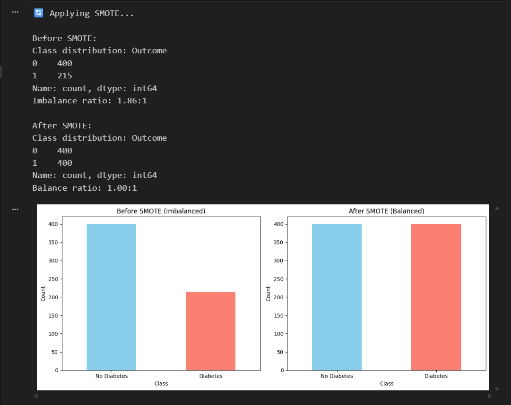
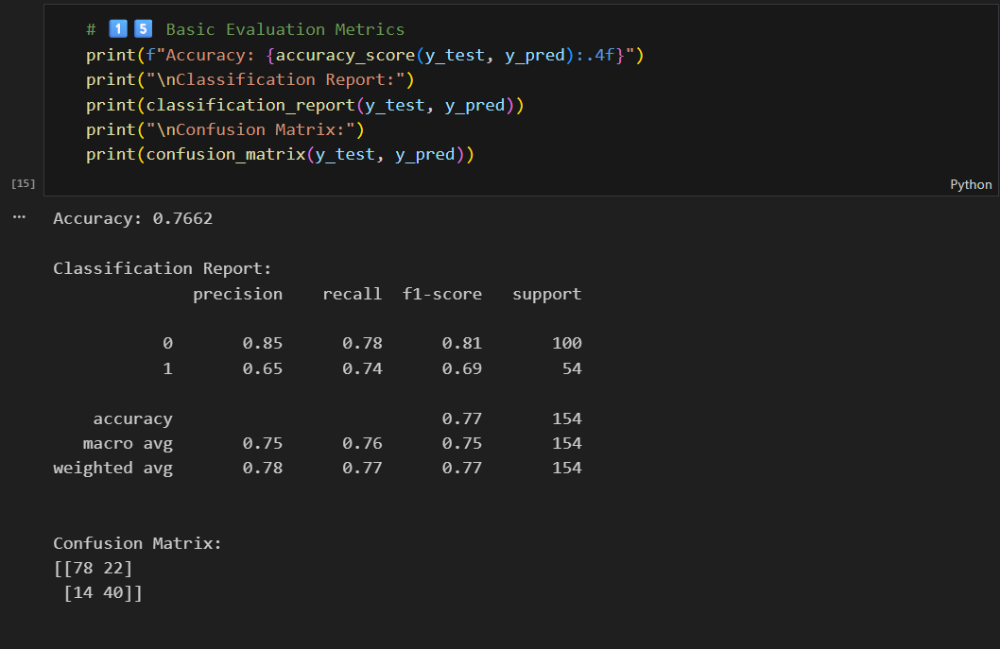
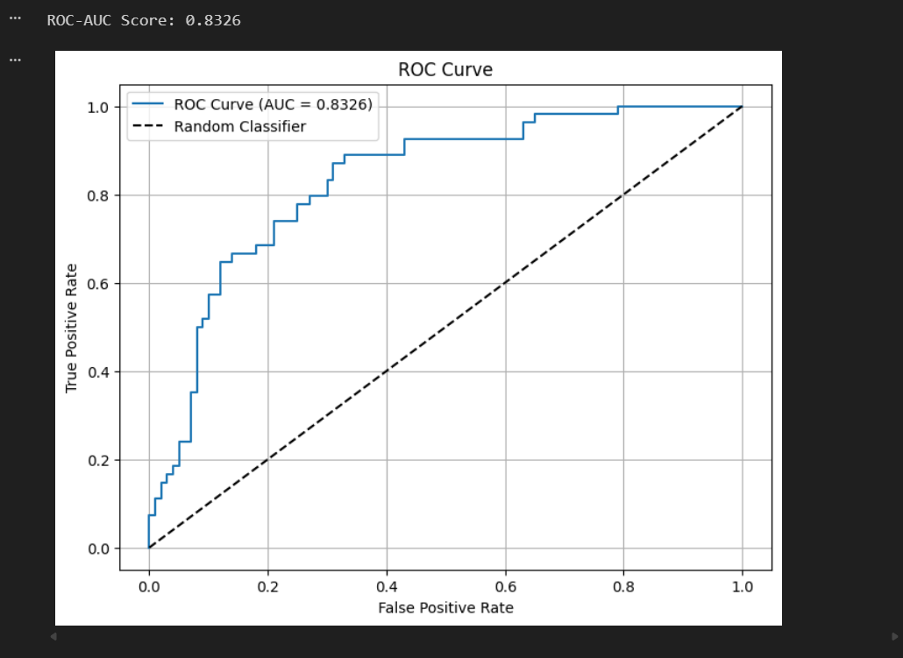
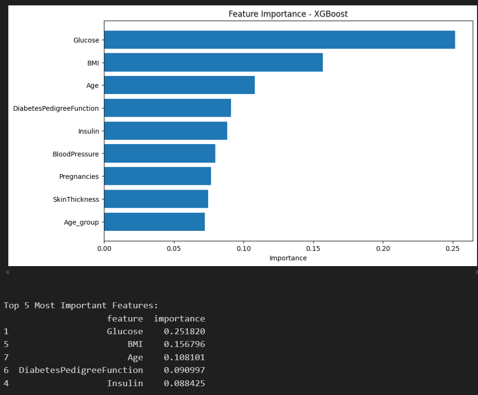

# 🏥 Diabetes Prediction with XGBoost & SMOTE

[](https://colab.research.google.com/github/Martin-Frei/diabetes-prediction/blob/master/XGBoost_SMOTE_Diabetes.ipynb)

A machine learning classification project for predicting diabetes using the Pima Indians Diabetes Dataset. This project demonstrates advanced ML techniques for handling imbalanced medical data using SMOTE (Synthetic Minority Over-sampling Technique) and XGBoost.



## 🎯 Project Overview

Diabetes is a chronic disease that affects millions worldwide. Early detection is crucial for effective treatment and prevention of complications. This project builds a classification model to predict diabetes based on diagnostic measurements, with special focus on handling class imbalance - a common challenge in medical datasets.

### Key Achievements

- **Accuracy:** 76.6%
- **ROC-AUC Score:** 83.3% (Very Good!)
- **Sensitivity (Recall):** 74.1% - Successfully identifies 74% of diabetic patients
- **Specificity:** 78.0% - Correctly identifies 78% of healthy individuals
- **F1-Score:** 71.2% at optimal threshold (0.272)

## 🔬 Problem Statement

### Medical Context

Diabetes screening faces two critical challenges:

1. **Class Imbalance:** Fewer diabetic cases than healthy cases in datasets
2. **High Cost of False Negatives:** Missing a diabetic patient (False Negative) is more dangerous than a false alarm (False Positive)

### Solution Approach

- **SMOTE:** Balance the training dataset to improve model sensitivity
- **Threshold Optimization:** Find the optimal decision threshold that maximizes detection of diabetic patients while maintaining reasonable precision

## 📊 Dataset

**Pima Indians Diabetes Dataset**

- **Source:** National Institute of Diabetes and Digestive and Kidney Diseases
- **Samples:** 768 female patients
- **Features:** 8 diagnostic measurements
- **Target:** Binary classification (Diabetes / No Diabetes)

### Features

| Feature | Description | Unit |
|---------|-------------|------|
| Pregnancies | Number of pregnancies | Count |
| Glucose | Plasma glucose concentration | mg/dL |
| BloodPressure | Diastolic blood pressure | mm Hg |
| SkinThickness | Triceps skin fold thickness | mm |
| Insulin | 2-Hour serum insulin | mu U/ml |
| BMI | Body mass index | kg/m² |
| DiabetesPedigreeFunction | Diabetes pedigree function | - |
| Age | Age | Years |

### Class Distribution

**Before SMOTE (Imbalanced):**
- No Diabetes (0): ~500 samples (65%)
- Diabetes (1): ~268 samples (35%)
- **Imbalance Ratio:** 1.87:1

**After SMOTE (Balanced):**
- No Diabetes (0): ~400 samples (50%)
- Diabetes (1): ~400 samples (50%)
- **Balance Ratio:** 1:1

## 🛠️ Technical Approach

### 1. Exploratory Data Analysis (EDA)

- **Boxplots:** Identified outliers in Age, BMI, and Pregnancies
- **Correlation Matrix:** Analyzed feature relationships
- **Age Group Analysis:** Created age groups for demographic insights
- **Scatter Plots:** Visualized feature relationships with outcomes

### 2. Feature Engineering

```python
# Age group categorization
bins = [20, 25, 30, 40, 50, 60, 70, 80, 90]
labels = ['21-25', '26-30', '31-40', '41-50', '51-60', '61-70', '71-80', '81-90']
df['Age_group'] = pd.cut(df['Age'], bins=bins, labels=labels)
```

### 3. Handling Class Imbalance with SMOTE

```python
from imblearn.over_sampling import SMOTE

smote = SMOTE(random_state=42)
X_train_smote, y_train_smote = smote.fit_resample(X_train, y_train)
```

**Why SMOTE?**
- Creates synthetic samples for minority class (diabetic patients)
- Prevents model from being biased toward majority class
- Improves sensitivity without losing too much precision

### 4. Model Training - XGBoost

```python
model = XGBClassifier(
    n_estimators=100,
    learning_rate=0.1,
    max_depth=5,
    random_state=42
)
model.fit(X_train_smote, y_train_smote)
```

**Why XGBoost?**
- Handles non-linear relationships effectively
- Built-in regularization prevents overfitting
- Fast training and prediction
- Provides feature importance

### 5. Threshold Optimization

Instead of using the default threshold (0.5), we optimized for the best F1-score:

```python
# Find optimal threshold
precision, recall, thresholds = precision_recall_curve(y_test, y_pred_proba)
f1_scores = 2 * recall * precision / (recall + precision)
best_threshold = thresholds[np.argmax(f1_scores)]
```

**Result:** Optimal threshold = **0.272** (instead of 0.5)

## 📈 Results

### Model Performance



| Metric | @ Threshold 0.5 | @ Threshold 0.272 | Improvement |
|--------|----------------|-------------------|-------------|
| **Accuracy** | 72.7% | **76.6%** | +3.9% ✅ |
| **Recall (Sensitivity)** | 59% | **74.1%** | +15.1% ✅ |
| **Precision** | 70% | **64.5%** | -5.5% |
| **F1-Score** | 64% | **71.2%** | +7.2% ✅ |
| **Specificity** | 80% | **78.0%** | -2% |

### ROC Curve



**ROC-AUC Score:** 0.8326 (83.3%)

**Interpretation:** The model correctly ranks a randomly chosen diabetic patient higher than a randomly chosen healthy patient 83.3% of the time.

### Feature Importance



**Top 5 Most Important Features:**
1. Glucose (most important)
2. BMI
3. Age
4. DiabetesPedigreeFunction
5. Pregnancies

## 🏥 Medical Perspective

### Why Optimized Threshold (0.272) Makes Sense

**Standard Threshold (0.5):**
- Balanced approach
- Misses 41% of diabetic patients (False Negatives)

**Optimized Threshold (0.272):**
- More conservative - flags patients earlier
- Catches 74% of diabetic patients (higher Recall) ✅
- Some healthy patients get re-tested (lower Precision)
- **Medical Justification:** Missing a diabetic patient is more dangerous than a false alarm

### Clinical Impact

```
Patient with 35% diabetes probability:
- Standard threshold (0.5): → "No Diabetes" → Patient goes untreated ❌
- Optimal threshold (0.272): → "Diabetes" → Patient gets further testing ✅
```

**Result:** Better screening tool that catches more cases requiring medical attention.


## 🚀 Getting Started

### Prerequisites

```bash
Python 3.8+
Jupyter Notebook or JupyterLab
```

### Installation

1. **Clone the repository**
   ```bash
   git clone https://github.com/Martin-Frei/diabetes-prediction.git
   cd diabetes-prediction
   ```

2. **Install dependencies**
   ```bash
   pip install -r requirements.txt
   ```

3. **Run the notebook**
   ```bash
   jupyter notebook XGBoost_SMOTE_Diabetes.ipynb
   ```

## 📂 Project Structure

```
diabetes-prediction/
├── XGBoost_SMOTE_Diabetes.ipynb    # Main analysis notebook
├── data/
│   └── diabetes.csv                  # Dataset
├── screenshots/
│   ├── smote_comparison.png
│   ├── confusion_matrix.png
│   ├── roc_curve.png
│   ├── feature_importance.png
│   └── final_results.png
├── models/
│   └── (trained models can be saved here)
├── requirements.txt
└── README.md
```

## 🔍 Key Learnings

### Technical Skills Demonstrated

- ✅ **Handling Imbalanced Data** - SMOTE implementation and evaluation
- ✅ **Advanced ML Metrics** - Beyond accuracy: ROC-AUC, precision, recall, F1-score
- ✅ **Threshold Optimization** - Finding optimal decision boundaries for specific use cases
- ✅ **Medical ML** - Understanding domain-specific evaluation criteria
- ✅ **Feature Engineering** - Creating meaningful features from raw data
- ✅ **Data Visualization** - Communicating results effectively

### Machine Learning Concepts

1. **Class Imbalance Problem:** Real-world datasets are often imbalanced
2. **Precision vs. Recall Trade-off:** Can't maximize both simultaneously
3. **Domain Knowledge Matters:** Medical applications require different evaluation criteria
4. **Threshold Selection:** Default 0.5 is not always optimal
5. **Model Interpretability:** Feature importance helps build trust in medical AI

## 🌱 Future Improvements

- [ ] **Hyperparameter Tuning:** Grid search or Bayesian optimization
- [ ] **Additional Features:** Include more medical measurements
- [ ] **Ensemble Methods:** Combine multiple models (Random Forest + XGBoost)
- [ ] **Cross-Validation:** K-fold CV for more robust evaluation
- [ ] **Model Deployment:** Flask API for real-time predictions
- [ ] **Explainability:** SHAP values for individual predictions
- [ ] **Cost-Sensitive Learning:** Assign different costs to False Negatives vs. False Positives

## 📚 References

- **Dataset:** [Pima Indians Diabetes Database](https://www.kaggle.com/datasets/uciml/pima-indians-diabetes-database)
- **SMOTE Paper:** Chawla, N. V., et al. (2002). "SMOTE: Synthetic Minority Over-sampling Technique"
- **XGBoost:** Chen, T., & Guestrin, C. (2016). "XGBoost: A Scalable Tree Boosting System"
- **Medical ML:** Beam, A. L., & Kohane, I. S. (2018). "Big Data and Machine Learning in Health Care"

## 🤝 Contributing

This is a portfolio project, but feedback and suggestions are welcome!

## 📄 License

This project is open source and available under the [MIT License](LICENSE).

## 👨‍💻 Author

**Martin Freimuth**
- GitHub: [@Martin-Frei](https://github.com/Martin-Frei)
- LinkedIn: [martin-freimuth](https://www.linkedin.com/in/martin-freimuth-089249359/)
- Email: mat.frei@gmx.de

---

## 🎯 Summary

This project demonstrates:
- Advanced ML techniques for **imbalanced medical data**
- Practical application of **SMOTE** for better minority class detection
- **Threshold optimization** for domain-specific requirements
- Professional ML evaluation using **ROC-AUC, F1-Score**, and medical metrics
- Strong understanding of **Precision vs. Recall trade-offs** in healthcare applications

**Key Result:** Achieved 83.3% ROC-AUC with 74% sensitivity - a reliable screening tool that catches 3 out of 4 diabetic patients while maintaining 78% specificity.

---

**⭐ If you found this project helpful, please consider giving it a star!**

*Built with Python, XGBoost, and a focus on real-world healthcare applications*
